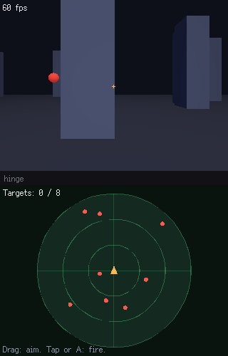
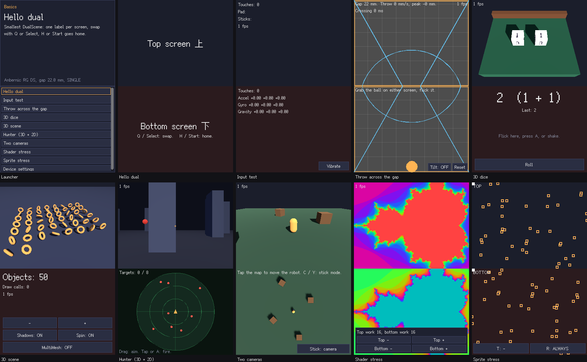

# Godot Dual Core

Examples and tests for [Dual Screen](https://github.com/P1tayaa/godot-dual-screen), a Godot 4.7 addon for games that
use two screens at once (like a Nintendo DS): dual-screen Android handhelds, two windows on desktop, stacked in one
window everywhere else.



**Tested on the Anbernic RG DS only** (and Linux desktop). See the addon's README for the status on other devices.

## Examples



| Example | Shows |
|---|---|
| Hello dual | the smallest `DualScene`: one label per screen, swap, home |
| Input test | touches on both screens (multitouch), gamepad buttons and sticks, accelerometer, gyroscope, vibration |
| Throw across the gap | one physics world in millimetres across both screens: flick a ball through the real hinge gap |
| 3D dice | physics dice in 3D on top, rolled from the bottom screen (flick, A, or shake the device) |
| 3D scene | a lit 3D scene on top; the bottom screen changes object count, shadows and animation |
| Hunter (3D + 2D) | first person 3D on top, a 2D radar below: drag to aim, tap to fire |
| Two cameras | one 3D world, two cameras: chase view on top, map below; tap the map to send the robot |
| Shader stress | a full screen shader on each screen, raise the work per pixel until frames drop |
| Sprite stress | moving sprites on both screens, switch the redraw mode and the second screen transport |
| Device settings | pick the device profile, line the screens up across the hinge |

Each example is one folder under `examples/` and one `ExampleEntry` resource in `data/examples/` that the launcher
lists.

## Run

Requires Godot 4.7.2 (with export templates for Android builds).

```bash
git clone --recurse-submodules https://github.com/P1tayaa/godot-dual-core.git
cd godot-dual-core
godot --path .                          # desktop: two windows (top + bottom)
godot --path . -- --screens=single      # stacked in one window
godot -e --path .                       # editor
```

Keys: arrows, Enter / Space to choose, Q (Select) swaps the screens, H (Start) goes back to the launcher. On desktop
the mouse acts as a finger.

Cloned without `--recurse-submodules`? Run `git submodule update --init`.

## Tests

```bash
godot --headless --path . --import      # once after cloning, and after adding a class_name or a translation key
godot --headless --path . --script res://addons/dual_screen/testing/run_tests.gd
```

## Android build

Needs the Android SDK, JDK 21, and Godot's editor settings pointing to them (plus a debug keystore).

```bash
export JAVA_HOME=/usr/lib/jvm/java-21-openjdk ANDROID_HOME=~/Android/Sdk
godot --headless --path . --install-android-build-template --export-debug "Android" exports/dual-core.apk
adb install -r exports/dual-core.apk
adb exec-out screencap -d 0 -p > bottom.png      # screenshot of one display (ids: adb shell dumpsys display)
```

## Documentation

| File | What |
|---|---|
| `addons/dual_screen/README.md` | the addon: install, first scene, modes, input, the gap, device profiles, Android |
| `addons/dual_screen/docs/PHILOSOPHY.md` | how projects on the addon are designed (data first, thin core, performance) |
| `addons/dual_screen/docs/CONVENTIONS.md` | folder layout, typing, naming, tests |
| `docs/ARCHITECTURE.md` | how the pieces fit: scenes, profiles, the physical world, Android display |
| `docs/DECISIONS.md` | decisions taken and the measurements behind them |
| `docs/NEW_GAME.md` | starting a new game on the addon |
| `docs/GAME_IDEAS.md` | ideas for more dual-screen games and tools |

## Licence

Code: MIT, see `LICENSE`. The Fusion Pixel font in the addon's theme is under the SIL Open Font License (licence
files next to it).

## TODO

- AYN Thor profile values are from the specs, not checked on a device.
- Measure the real RG DS hinge gap (22 mm is an estimate).
